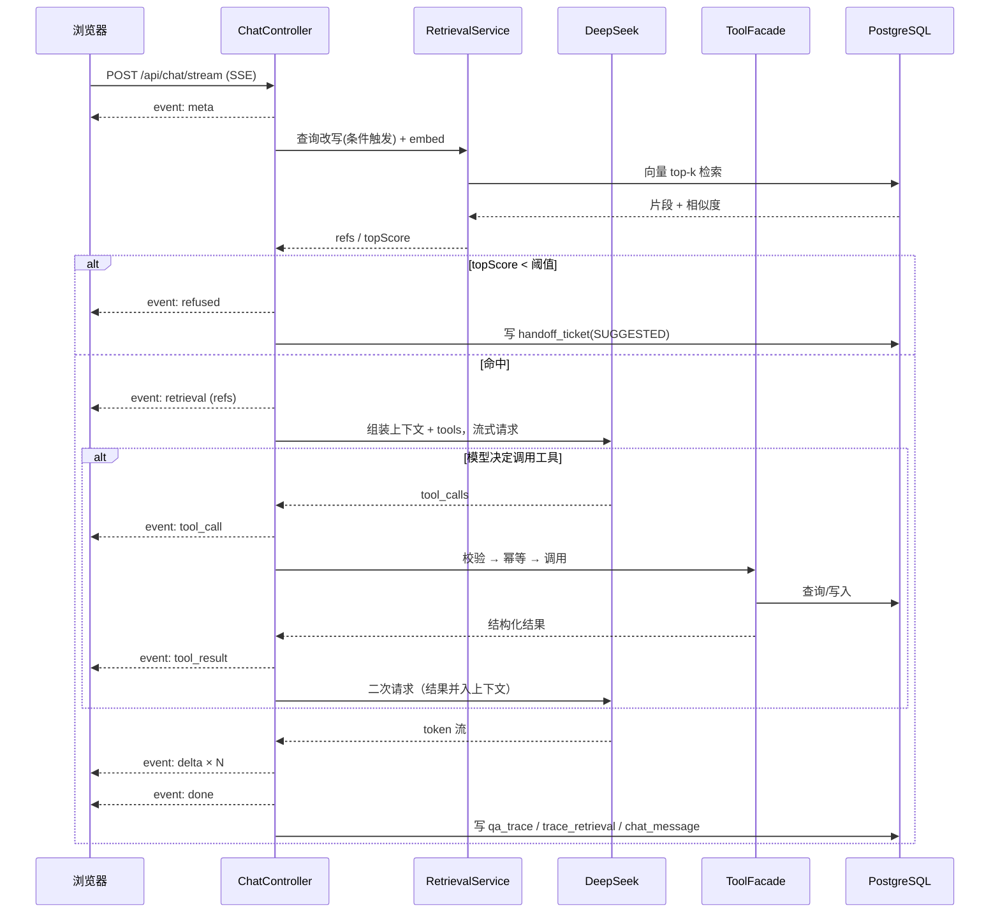

# AICS 企业智能客服 Agent 平台 — 技术设计文档（MVP）

| 项目 | 内容 |
|------|------|
| 上游文档 | 《产品设计文档 V0.1（MVP）》 |
| 文档版本 | V0.1 |
| 编写日期 | 2026-11-20 |
| 覆盖范围 | 技术选型、模块划分、表结构、检索链路、流式协议、Prompt 设计、评测方案 |
| 不覆盖 | 前端组件细节、生产级运维（监控/告警/编排）、多租户隔离、混合检索与重排 |

> 本文的目标是：**看完能直接开工，且每个技术决策都说得出为什么。**
> 产品层面的「做什么」以上游产品文档为准，本文只回答「怎么实现」。

---

## 0. 已确定的前置决策

| 编号 | 决策 | 结论 | 影响 |
|------|------|------|------|
| D1 | 项目定位 | 求职作品，同时具备可演示的完整度 | 优先「讲得清、可度量」，而非吞吐与运维 |
| D2 | 对话模型 | DeepSeek 官方 API | 必须处理「无 Embedding 接口」这一问题 |
| D3 | 前端 | 复用 `demo/index.html`，替换数据源 | 接口协议必须与 demo 现有数据结构对齐 |
| D4 | 切片策略 | 按 Markdown 标题层级结构化切片 | 需要 Section 树解析，而非定长切分 |

本方案在此基础上补充了四项决策（D5–D8），理由见第 1 节。

| 编号 | 决策 | 结论 |
|------|------|------|
| D5 | 主语言与框架 | Java 21 + Spring Boot 3（MVC）+ Spring AI |
| D6 | 存储 | PostgreSQL 16 + pgvector，单实例承载全部数据 |
| D7 | 流式实现 | `SseEmitter`，事件协议自定义 |
| D8 | 框架使用深度 | Spring AI 只托管模型调用与工具循环，检索链路自研 |

---

## 1. 技术选型

### 1.1 为什么是 Java

产品文档的非功能要求（单体、不拆微服务、不做 MQ、不做多租户）已经把基础设施的复杂度压到很低。剩下真正难的两件事是**「流式 + 工具循环」的编排**和**「评测闭环」**，这两件跟语言关系不大，跟「开发者对栈的熟悉度」关系很大。

在此基础上，Java 还多两个好处：

- 目标岗位画像就是「Java + AI Agent」，这个项目本身即履历；
- 单体应用 + 一个数据库，Java 的启动开销和内存占用在这个量级完全不是问题（10 路并发）。

M5 若引入混合检索与重排，Python 生态会更有优势，但那时可以单独加一个 rerank 服务，不影响主栈。

### 1.2 为什么不用 WebFlux

流式 SSE 天然适合响应式，但代价是整条链路都要响应式（R2DBC、非阻塞事务），与 JPA/MyBatis 混用会陷入线程模型混乱。

MVP 只有 10 路并发，Servlet 容器的线程池绰绰有余。因此选 **Spring MVC + `SseEmitter`**，在 SSE 端点内部订阅 Spring AI 返回的 `Flux` 并桥接到 emitter：

```java
Flux<String> flux = chatClient.prompt()...stream().content();
Disposable sub = flux.subscribe(
    token -> sink.send("delta", Map.of("text", token)),
    err   -> sink.error(err),
    ()    -> sink.complete()
);
emitter.onCompletion(sub::dispose);
emitter.onTimeout(sub::dispose);
```

代价是要自己处理「emitter 写并发」和「客户端断开后的取消」，但这两件事各十行代码就能做对，比整条链路响应式化的成本低得多。

### 1.3 模型与 Embedding：必须承认的限制

**DeepSeek 开放平台只提供对话补全（含 function calling），没有 Embedding 接口。** 这是选型时最容易踩的坑——聊天模型和嵌入模型是两套东西，前者读问题写答案，后者把文本变成向量。

因此配置上必须支持**两个独立的 provider**：

| 用途 | 服务 | 模型 | 维度 |
|------|------|------|------|
| 对话生成 + 工具调用 + 查询改写 | DeepSeek 官方 API | `deepseek-flash` | — |
| 向量化 | 任一 OpenAI 兼容 Embedding 服务 | `BAAI/bge-m3` | 1024 |

Embedding 具体走哪家由配置决定，MVP 阶段建议用云端 API（零运维、不用下载几个 GB 的模型文件），备选本地 Ollama + bge-m3。因为两者都是 OpenAI 兼容协议，切换只需要改 `base-url` + `model` + `dimensions`。

> **注意模型 ID**：`deepseek-chat` / `deepseek-reasoner` 已于 2026-07-24 下线，当前可用的是 `deepseek-flash` 与 `deepseek-v4-pro`。本项目的问答场景用 `deepseek-flash` 即可，成本约为 pro 的三分之一。

> **注意思考模式**：DeepSeek V4 系列默认开启 thinking，会显著抬高首字延迟，且思考过程可能与工具调用相互干扰。首字 ≤1.5s 是硬指标，必须在请求中显式关闭思考模式，并确保 `reasoning_content` 不会被当作 `delta` 推给前端。

### 1.4 为什么是 pgvector 而不是独立向量库

产品文档 4.1 有一条验收要求：**「删除文档时同步清除其全部切片与向量」**。向量和元数据在同一个数据库里，这句话就是一行 `ON DELETE CASCADE`；拆成 Postgres + Chroma/Milvus 两个系统，就要额外做一致性对账，还要处理「向量已删、元数据没删」的中间态。

其余理由：

- 部署形态要求「Docker Compose 一键启动依赖」，一个 `pgvector/pgvector:pg16` 容器就够，不用再拉第二个服务；
- 10 路并发、万级切片，pgvector 的 HNSW 索引毫无压力；
- Trace 表要按 `trace_id` 关联召回片段，同库可以直接 JOIN，跨库就得在应用层拼装。

代价是 pgvector 的索引调优能力不如专用向量库（比如不支持多副本分片），但那是 M5 之后的事。

### 1.5 框架用到什么程度

**Spring AI 负责：模型调用、流式输出、function calling 的工具注册与多轮循环、多轮消息结构。**
**自己负责：切片、检索、上下文组装、引用标注、阈值判定、Trace、评测。**

不用 `QuestionAnswerAdvisor` 这类「检索 + 拼 Prompt + 挂引用」一把梭的封装，原因是它恰好把本项目最需要观测的中间结果全包起来了：

| 需要的能力 | 封装后的问题 |
|------|------|
| 每个片段的相似度（阈值判定、Trace） | 拿不到，除非反射进内部结构 |
| 引用定位到「第 2.3 节」 | 元数据在组装时已丢失 |
| Recall@5 要拿到真实召回顺序 | 顺序被重排或截断过 |
| 拒答靠阈值而非模型自觉 | 检索与生成耦合，无法在生成前拦截 |

自研这部分约 300 行，换来的是每个环节都可测、可观测、可解释。

---

## 2. 整体架构

### 2.1 分层

```
┌────────────────────────────────────────────────┐
│ 浏览器  demo/index.html（复用，仅换数据源）      │
└───────────────────┬────────────────────────────┘
                    │ HTTP + SSE
┌───────────────────▼────────────────────────────┐
│ Spring Boot 3 单体进程                          │
│                                                │
│  web        Controller / SSE 端点 / 异常处理    │
│  kb         文档解析、结构化切片、向量化入库     │
│  retrieval  查询改写、向量检索、阈值过滤、引用装配│
│  chat       上下文组装、Prompt、流式编排、记忆   │
│  tool       工具门面（校验/幂等/超时/降级）      │
│  trace      阶段计时、落库                       │
│  eval       评测集执行与指标计算（CLI）          │
│  common     配置、TraceContext、SseSink         │
└──────┬──────────────────────────┬──────────────┘
       │                          │
┌──────▼──────────┐   ┌───────────▼─────────────┐
│ PostgreSQL 16   │   │ DeepSeek API（对话）      │
│ + pgvector      │   │ Embedding API（向量化）   │
└─────────────────┘   └─────────────────────────┘
```

### 2.2 一次问答的时序



---

## 3. 模块设计

### 3.1 知识入库

**状态机**：`PENDING → PROCESSING → READY | FAILED`

上传接口同步完成「落库 + 状态置 PENDING」后立即返回，随后异步线程池处理解析与向量化。这样上传接口不会被 Embedding 调用拖到几秒以上。

```
上传 (multipart)
  → 校验扩展名 (.md/.txt) 与大小 (≤10MB)
  → 计算 sha256，同内容重复上传直接复用已有文档
  → 写 kb_document(status=PENDING)
  → 提交线程池 async_ingest
        → status=PROCESSING
        → 解析 → 结构化切片
        → 批量 Embedding（batch=16，失败重试 2 次，指数退避）
        → 事务内写 kb_chunk（向量 + 元数据）
        → status=READY, chunk_count=n, processed_at=now()
  → 任何异常 → status=FAILED, error_msg=<可读原因>
```

**失败可读性**是产品验收点之一，`error_msg` 必须是用户能看懂的话（如「文件编码无法识别，请另存为 UTF-8」），而不是堆栈。

**Embedding 缓存**：`content_sha256` 相同的切片直接复用向量，避免重建文档时重复计费。落地为 `kb_chunk` 上的普通索引查询。

### 3.2 结构化切片（D4）

不采用定长窗口，而是按 Markdown 标题层级切，理由是引用溯源要定位到「第 2.3 节」，而定长切分会在章节中间断开，既丢结构也丢语义。

#### 3.2.1 流程

```
1. 归一化：CRLF→LF，去除行尾空白，统一代码围栏
2. 线性扫描 ATX 标题（^#{1,6}\s），构建 Section 树
3. 每个叶子 Section 得到 (headingPath, headingText, level, body, charStart, charEnd)
4. 后处理：
   a) body 为空            → 丢弃（纯标题节点）
   b) body < minChars      → 与下一个兄弟节点合并，合并上限 maxChars
   c) body > maxChars      → 按空行分段聚合；单段仍超长则按句末标点二次切分，
                             相邻窗口保留 overlapChars 重叠
   d) 表格（连续以 | 开头的行）与代码块（``` 围栏）视为原子单元，不拆分；
      单个原子单元超 maxChars 时整块保留并标记 oversized=true
5. 产出 chunk：headingText 供引用展示，headingPath 供向量化增强
```

#### 3.2.2 关键设计：向量化文本与展示文本分离

- `content`（存原文，用于展示与引用回看）
- `embed_text` = `【headingPath】\n` + `content`（仅用于向量化，不落库、不回显）

**为什么这么做**：结构化切片天然偏短（一个 2.3 节可能只有 120 字），短文本的向量缺少上下文，容易出现「问的是退货运费，召回的却是保修条款」这类近邻误判。在向量化前拼上章节路径，等于给每个片段补了一句「我是谁的一部分」，成本为零，对短切片召回提升明显。

#### 3.2.3 示例

输入 `售后服务政策-v3.md`：

```markdown
# 售后服务政策 v3

## 2. 退货与换货
### 2.1 七天无理由适用条件
商品需保持完好、配件与包装齐全、不影响二次销售，且需在签收后 7 日内提交申请。

### 2.3 退货运费承担
七天无理由退货的退回运费由消费者承担；因商品质量问题、错发漏发产生的往返运费由商家承担。
```

产出：

| chunk_index | heading_path | heading_text | content |
|---|---|---|---|
| 0 | 2. 退货与换货 > 2.1 七天无理由适用条件 | 2.1 七天无理由适用条件 | 商品需保持完好… |
| 1 | 2. 退货与换货 > 2.3 退货运费承担 | 2.3 退货运费承担 | 七天无理由退货的退回运费… |

前端引用条显示 `售后服务政策-v3.md · 2.3 退货运费承担`，与 `demo/index.html` 现有结构一致。

#### 3.2.4 参数

| 参数 | 默认值 | 说明 |
|------|--------|------|
| `chunking.max-chars` | 800 | 超过则二次切分 |
| `chunking.min-chars` | 120 | 低于则向后合并 |
| `chunking.overlap-chars` | 80 | 二次切分的重叠 |
| `chunking.max-heading-level` | 3 | H1–H3 作为切分边界，H4+ 视为正文 |

修改参数只影响新建文档；已有文档通过「重建」接口重新切片（MVP 只提供接口，不做批量 UI）。

### 3.3 检索链路

```
query
 ├─ 改写门控（见 3.3.1）
 │    ├─ 触发 → LLM 改写为独立问题（temp=0, max_tokens=64）
 │    └─ 不触发 → 直接用原问题
 ├─ embed(queryUsed) → vector(1024)
 ├─ SELECT ... ORDER BY embedding <=> $1 LIMIT topK
 ├─ score = 1 - cosine_distance
 ├─ 过滤 score < threshold
 ├─ 单文档限流：同一 doc 最多保留 3 条，防止上下文被单个文档占满
 └─ 按 score 降序注入编号 [1..n] → refs
```

#### 3.3.1 查询改写：解决「那过了保修期维修怎么收费」

产品文档场景三要求系统理解「那」指向保修话题。如果直接把这句话拿去向量检索，召回质量会很差。

但改写是有代价的：多一次模型往返，几百毫秒，直接影响首字 ≤1.5s 的指标。因此采用**条件门控**：

```
if 会话无历史:            不改写
else if 字数 < 12:        改写
else if 命中指代/承接词:   改写   # 那|这个|它|还有|呢|那如果是|继续
else if 上一轮有工具追问:  改写   # 上轮在等订单号，用户可能只回了个号码
else:                     不改写
```

命中率估计在三成左右，平均额外延迟可控。Trace 中记录 `rewritten` 与 `query_used`，便于用评测集验证「改写到底有没有用」——如果数据证明没用，一条配置就关掉。

#### 3.3.2 阈值必须校准，不能照搬

初始值 `0.70`（与 demo 保持一致），但**这个数字不能直接从别处抄**。不同 Embedding 模型的相似度分布差异很大：同为不相关文本，bge-m3 可能落在 0.35–0.55，某些模型则能到 0.7 以上。阈值定高了全是拒答，定低了该拒的不拒——**拒答准确率直接由它决定**。

因此 M1 阶段必须做一次校准：把评测集里正例与负例的 top1 分数各画一条分布，取两条分布之间误判代价最小的切点。这一步不做，第 8 节的指标就无从谈起。

### 3.4 流式编排与工具循环

#### 3.4.1 SSE 事件协议

与 `demo/index.html` 的数据结构对齐，前端只需把 `setTimeout` 假流式换成 `EventSource`/`fetch` 真流式。

| event | 时机 | data |
|-------|------|------|
| `meta` | 立刻 | `{traceId, sessionId, turn}` |
| `retrieval` | 检索完成，**首字之前** | `{topScore, threshold, refs:[{index, chunkId, doc, sec, score, snip}]}` |
| `tool_call` | 模型决定调工具 | `{callId, name, args}`（args 为便于展示的字符串） |
| `tool_result` | 工具返回 | `{callId, ok, costMs, rows:[[k,v]], errorCode}` |
| `delta` | 每个 token | `{text}` |
| `refused` | 命中拒答分支 | `{reason, topScore, threshold, suggestHandoff}` |
| `done` | 结束 | `{messageId, tokens:{in,out}, stages:[[name,ms]], cited:[1,2]}` |
| `error` | 异常 | `{code, message}` |

事件顺序固定为：`meta → retrieval → (tool_call → tool_result)* → delta* → done`，拒答则为 `meta → refused → done`。

`retrieval` 先于 `delta` 推送，前端缓存 refs，等回答结束后再渲染引用块——这正是 demo 现有行为。

#### 3.4.2 工具循环在 Spring AI 中如何落地

Spring AI 的 `ChatClient.stream().tools(...)` 在模型返回 `tool_calls` 时会自动执行工具并再次请求模型，续在同一段 `Flux` 上。也就是说：

- 模型直接回答 → 用户立刻看到 token；
- 模型决定调工具 → 工具执行期间没有 token，执行完后才开始吐字 → 恰好是「先出工具卡片、再出文字」的期望顺序。

无需自己写循环，但需要拿到「工具被调用」这个中间事件来推送 `tool_call`。做法是通过 `toolContext` 把当次请求的上下文传进工具方法：

```java
chatClient.prompt()
    .system(systemPrompt)
    .user(userPrompt)
    .tools(orderTool, logisticsTool, ticketTool)
    .toolContext(Map.of("sink", sseSink, "trace", traceCtx, "sessionId", sessionId))
    .stream()
    .content();
```

工具方法签名的第一个参数接收 `ToolContext`，从中取 `sink` 推事件、取 `trace` 记耗时。**不要用 ThreadLocal**——工具执行可能发生在 Reactor 的另一个线程上，ThreadLocal 会丢。

#### 3.4.3 `SseEmitter` 的三个必须处理的点

| 问题 | 处理 |
|------|------|
| 并发写 | 所有 `send` 收敛到一个 `SseSink`，内部 `synchronized` + `AtomicBoolean closed`，关闭后丢弃后续写 |
| 客户端断开 | `onCompletion` / `onError` / `onTimeout` 里 `dispose` 掉 `Flux` 订阅，避免模型继续计费 |
| 长连接超时 | emitter 超时设 180s；每 15s 发一次注释心跳 `: ping`，防止中间层掐连接 |

#### 3.4.4 首字延迟的控制

目标 ≤1.5s，链路分解（估算，需实测校准）：

| 阶段 | 预算 |
|------|------|
| 查询改写（条件触发） | 0 或 ~400ms |
| Embedding | ~120ms |
| 向量检索 | ~30ms |
| 上下文组装 | ~10ms |
| 模型首字（关闭 thinking） | ~600–900ms |
| **合计** | **~800ms 或 ~1200ms** |

余量不大，因此：**关闭 thinking、控制 system prompt 长度（≤400 token）、限制注入片段数（topK 默认 6）**，这三条是必做项而非优化项。

### 3.5 工具调用

#### 3.5.1 分层

```
@Tool 方法（Spring AI 可见，只做 schema）
    └→ ToolFacade（真正的执行入口）
         ├ 参数规范校验（格式 / 必填）
         ├ 幂等键计算与查重
         ├ 超时控制（3s）
         ├ 下游异常 → 错误码映射
         ├ 推送 tool_call / tool_result 事件
         └ Trace 落库（参数脱敏）
              └→ OrderService / LogisticsService / TicketService
                    └→ Repository → mock_order / mock_logistics_event / support_ticket
```

工具层只依赖 `interface OrderService`，MVP 的实现是查模拟表，将来换真实服务只替换实现类。

#### 3.5.2 三个工具

| 工具 | 类型 | 入参 | 出参 |
|------|------|------|------|
| `query_order` | 只读 | `orderNo` | `status, placedAt, amount, itemSummary` |
| `query_logistics` | 只读 | `orderNo` | `carrier, waybillNo, latestNode` |
| `create_ticket` | 写入 | `description, contact, sessionId` | `ticketNo, etaHours` |

#### 3.5.3 错误码与降级话术

模型看到的是结构化错误码，用户看到的是人话。两者必须分离，否则会漏出技术细节。

| 错误码 | 触发 | 用户可见话术 |
|--------|------|--------------|
| `ORDER_NOT_FOUND` | 订单号不存在 | 未查询到该订单，请确认订单号是否正确 |
| `ORDER_CANCELLED` | 订单已取消 | 该订单已取消，如有疑问可以为您转接人工 |
| `NO_LOGISTICS` | 未发货 | 订单尚未发货，暂无物流信息 |
| `DOWNSTREAM_TIMEOUT` | 超时 | 查询暂时没有响应，请稍后再试 |
| `INVALID_ARGS` | 参数格式错 | **不展示**，交由模型追问补齐 |

`INVALID_ARGS` 不直接答用户，是为了满足「参数缺失时由 Agent 追问补齐，而不是直接报错」。

#### 3.5.4 幂等

```
idem_key = sha256(sessionId | toolName | canonicalJson(args))
```

- `canonicalJson`：key 字典序、去空白、数字统一格式，保证语义相同则键相同；
- `tool_invocation` 表上 `UNIQUE (session_id, tool_name, idem_key)`；
- 插入冲突即视为重复提交，直接返回已存 `result`，并标记 `replayed=true`；
- 幂等窗口：同一会话内长期有效（MVP 不做 TTL）。

`create_ticket` 必须幂等，这是产品文档的明确要求（同一会话重复提交不产生重复工单）。只读工具也走同一套，成本近乎为零，但能顺带把「模型重复调用同一工具」挡掉。

#### 3.5.5 模拟数据

20 条订单，必须覆盖正常、异常、边界三类：

| 场景 | 数量 | 用途 |
|------|------|------|
| 已签收 | 6 | 正常查询 |
| 运输中 | 6 | 物流节点展示 |
| 已取消 | 3 | `ORDER_CANCELLED` |
| 已付款未发货 | 3 | `NO_LOGISTICS` |
| 不存在的订单号 | 2 | `ORDER_NOT_FOUND`（用固定号段便于演示） |

订单号格式统一 `SO` + 12 位数字（如 `SO202611180032`），与 demo 中的校验正则一致。

### 3.6 多轮记忆

| 层 | 内容 | 上限 |
|----|------|------|
| 近期 | 最近 6 轮（12 条消息）原文 | 由 `memory.recent-turns` 控制 |
| 远期 | 早期对话压缩为摘要，存 `chat_session.summary` | 300 字 |
| 摘要水位 | `summary_upto_seq` 记录摘要覆盖到第几条 | — |

超过 12 轮时触发压缩：把 `summary_upto_seq` 之后、近期窗口之前的消息合并进摘要，`summary_upto_seq` 前移。压缩用一次 temp=0 的模型调用，约 300ms，发生在流式开始前，会占用首字预算——因此只在「轮次跨越阈值」的那一次承担这个开销，而不是每轮都做。

DeepSeek V4 的上下文窗口是 1M token，窗口完全不是瓶颈。真正的约束是**成本与延迟**：每轮把全量历史塞进去，prompt token 会线性增长。因此预算按「片段 2500 + 历史 1500 + system 400 + 输出预留 1024」分配。

### 3.7 兜底与转人工

#### 3.7.1 两层拒答

| 层 | 机制 | 特点 |
|----|------|------|
| L1 确定性 | 检索最高分 < 阈值 → **不调用生成模型**，直接返回固定话术 | 100% 可控，指标不依赖模型自觉 |
| L2 兜底 | 模型仍输出「不知道/无法回答」→ 标记 `refused=true`，补上转人工入口 | 覆盖阈值漏网的情况 |

L1 是关键设计：把拒答从「模型行为」变成「系统行为」，拒答准确率才可度量、可回归。

#### 3.7.2 队列状态

产品文档里「场景四说会话进入待处理队列」与「4.4 说系统主动建议转人工」两种表述略有张力，用状态字段统一：

| status | 含义 | 触发 |
|--------|------|------|
| `SUGGESTED` | 系统建议转人工，但用户还没点 | 拒答、工具连续失败 |
| `WAITING` | 用户已点击转人工，进入待接管队列 | 用户点击 |
| `HANDLED` | 已处理（MVP 只提供人工置位的接口） | 手动 |

前端队列视图只展示 `WAITING`，与 demo 中 2 条记录的呈现一致。

### 3.8 Trace

每次问答一条 `qa_trace`，召回明细进 `trace_retrieval`（便于算 Recall@5），阶段耗时存 `stages` JSONB。

阶段用 try-with-resources 计时，避免手写 `System.currentTimeMillis()` 到处漏：

```java
try (Stage s = traceCtx.stage("检索")) { ... }   // 自动记录 elapsed
```

**异步落库**：`done` 事件发出后再写库，不占用首字预算。写失败只打日志，不影响用户请求——Trace 是旁路，不能让它成为可用性的单点。

### 3.9 评测

#### 3.9.1 评测集格式

`eval/cases.jsonl`，每行一条：

```json
{"id":"c001","question":"七天无理由退货的运费谁承担","expectDoc":"售后服务政策-v3.md","expectSection":"2.3 退货运费承担","expectKeywords":["消费者承担"],"shouldRefuse":false,"history":[]}
{"id":"c002","question":"那过了保修期维修怎么收费","expectDoc":"产品保修条款.md","expectSection":"2.2 保外维修收费标准","shouldRefuse":false,"history":[{"role":"user","content":"你们的保修期多久"},{"role":"assistant","content":"整机保修 12 个月…"}]}
{"id":"c003","question":"你们公司在东南亚有代理吗","shouldRefuse":true,"history":[]}
```

字段设计要点：`expectSection` 让检索可以被自动判定；`history` 让多轮场景可复现；`shouldRefuse` 让拒答准确率可计算。

#### 3.9.2 指标口径

| 指标 | 计算方式 | 说明 |
|------|----------|------|
| Recall@5 | 期望片段出现在 top-5 的条数 / 可回答条数 | 只看检索，不看生成 |
| 引用覆盖率 | 携带 ≥1 条有效引用的知识类回答 / 知识类回答总数 | 目标 100% |
| 拒答准确率 | 正确拒答的负例数 / 负例总数 | 只统计 `shouldRefuse=true` |
| 引用准确率 | 人工判定「引用确实支撑回答」的比例 | 需人工，脚本导出评审表 |
| 首字延迟 | Trace 中 `ttft_ms` 的 p50 / p95 | 来自真实请求，不单独压测 |

引用准确率无法自动判定——这一点必须承认。脚本负责把「问题 + 回答 + 引用片段」导出成 CSV 评审表，人工打勾后回读计算。**不要用 LLM-as-judge 替代**，产品文档也明确把自动评估排除在 MVP 之外。

#### 3.9.3 执行方式

```bash
# 全量跑，输出 Markdown 报告
java -jar aics.jar --eval=eval/cases.jsonl --out=eval/report-$(date +%F).md

# 只跑检索（快，不产生模型生成费用）
java -jar aics.jar --eval=eval/cases.jsonl --mode=retrieval
```

评测默认走**进程内服务调用**而非 HTTP，速度快且不受 SSE 影响；另提供 `--mode=http` 做端到端冒烟。

温度固定 0，生成类指标跑 3 次取均值，避免单次抖动被当成策略效果。

---

## 4. 数据表设计

迁移脚本：`src/main/resources/db/migration/V1__init.sql`（Flyway）。

```sql
CREATE EXTENSION IF NOT EXISTS vector;

-- ========== 知识库 ==========
CREATE TABLE kb_document (
    id             BIGSERIAL    PRIMARY KEY,
    tenant_id      BIGINT       NOT NULL DEFAULT 1,   -- 预留，MVP 不隔离
    filename       VARCHAR(255) NOT NULL,
    size_bytes     BIGINT       NOT NULL,
    content_sha256 CHAR(64)     NOT NULL,
    status         VARCHAR(16)  NOT NULL,             -- PENDING/PROCESSING/READY/FAILED
    error_msg      TEXT,
    chunk_count    INT          NOT NULL DEFAULT 0,
    uploaded_at    TIMESTAMPTZ  NOT NULL DEFAULT now(),
    processed_at   TIMESTAMPTZ
);
CREATE INDEX idx_kb_doc_status ON kb_document (status);
CREATE INDEX idx_kb_doc_sha    ON kb_document (content_sha256);

CREATE TABLE kb_chunk (
    id            BIGSERIAL    PRIMARY KEY,
    doc_id        BIGINT       NOT NULL REFERENCES kb_document(id) ON DELETE CASCADE,
    chunk_index   INT          NOT NULL,
    heading_path  VARCHAR(512) NOT NULL,
    heading_text  VARCHAR(255) NOT NULL,
    heading_level SMALLINT     NOT NULL,
    content       TEXT         NOT NULL,
    char_start    INT          NOT NULL,
    char_end      INT          NOT NULL,
    token_count   INT          NOT NULL,
    oversized     BOOLEAN      NOT NULL DEFAULT false,
    embedding     vector(1024) NOT NULL,
    created_at    TIMESTAMPTZ  NOT NULL DEFAULT now(),
    UNIQUE (doc_id, chunk_index)
);
CREATE INDEX idx_kb_chunk_doc  ON kb_chunk (doc_id);
CREATE INDEX idx_kb_chunk_vec  ON kb_chunk USING hnsw (embedding vector_cosine_ops)
    WITH (m = 16, ef_construction = 64);

-- ========== 会话 ==========
CREATE TABLE chat_session (
    id               BIGSERIAL    PRIMARY KEY,
    tenant_id        BIGINT       NOT NULL DEFAULT 1,
    title            VARCHAR(120) NOT NULL DEFAULT '新会话',
    status           VARCHAR(16)  NOT NULL DEFAULT 'ACTIVE',  -- ACTIVE/HANDOFF/CLOSED
    summary          TEXT,
    summary_upto_seq INT          NOT NULL DEFAULT 0,
    created_at       TIMESTAMPTZ  NOT NULL DEFAULT now(),
    updated_at       TIMESTAMPTZ  NOT NULL DEFAULT now()
);

CREATE TABLE chat_message (
    id         BIGSERIAL   PRIMARY KEY,
    session_id BIGINT      NOT NULL REFERENCES chat_session(id) ON DELETE CASCADE,
    seq        INT         NOT NULL,
    role       VARCHAR(16) NOT NULL,        -- user/assistant/tool
    content    TEXT        NOT NULL,
    refs       JSONB,
    tool_calls JSONB,
    trace_id   VARCHAR(32),
    created_at TIMESTAMPTZ NOT NULL DEFAULT now(),
    UNIQUE (session_id, seq)
);

-- ========== 可观测 ==========
CREATE TABLE qa_trace (
    id                 VARCHAR(32) PRIMARY KEY,
    session_id         BIGINT      REFERENCES chat_session(id) ON DELETE CASCADE,
    message_id         BIGINT,
    turn               INT         NOT NULL,
    query_raw          TEXT        NOT NULL,
    query_used         TEXT        NOT NULL,   -- 改写后实际检索用的
    rewritten          BOOLEAN     NOT NULL DEFAULT false,
    top_score          REAL        NOT NULL,
    threshold          REAL        NOT NULL,
    refused            BOOLEAN     NOT NULL DEFAULT false,
    tool_used          VARCHAR(64),
    ttft_ms            INT,
    total_ms           INT,
    prompt_tokens      INT,
    completion_tokens  INT,
    stages             JSONB,
    created_at         TIMESTAMPTZ NOT NULL DEFAULT now()
);
CREATE INDEX idx_trace_created ON qa_trace (created_at DESC);

CREATE TABLE trace_retrieval (
    trace_id VARCHAR(32) NOT NULL REFERENCES qa_trace(id) ON DELETE CASCADE,
    chunk_id BIGINT      NOT NULL,
    rank     INT         NOT NULL,
    score    REAL        NOT NULL,
    cited    BOOLEAN     NOT NULL DEFAULT false,
    PRIMARY KEY (trace_id, chunk_id)
);

-- ========== 工具 ==========
CREATE TABLE tool_invocation (
    id          BIGSERIAL   PRIMARY KEY,
    session_id  BIGINT      NOT NULL,
    trace_id    VARCHAR(32) NOT NULL,
    tool_name   VARCHAR(64) NOT NULL,
    idem_key    CHAR(64)    NOT NULL,
    args_masked JSONB       NOT NULL,        -- 联系方式等已脱敏
    status      VARCHAR(16) NOT NULL,        -- OK/ERROR/TIMEOUT
    error_code  VARCHAR(32),
    result      JSONB,
    latency_ms  INT         NOT NULL,
    replayed    BOOLEAN     NOT NULL DEFAULT false,
    created_at  TIMESTAMPTZ NOT NULL DEFAULT now(),
    UNIQUE (session_id, tool_name, idem_key)
);

-- ========== 人工接管 ==========
CREATE TABLE handoff_ticket (
    id              BIGSERIAL    PRIMARY KEY,
    session_id      BIGINT       NOT NULL REFERENCES chat_session(id) ON DELETE CASCADE,
    reason_code     VARCHAR(32)  NOT NULL,   -- USER_REQUEST/LOW_CONFIDENCE/TOOL_FAILURE/OUT_OF_SCOPE
    reason_text     VARCHAR(255),
    question_digest VARCHAR(255) NOT NULL,
    status          VARCHAR(16)  NOT NULL DEFAULT 'SUGGESTED',  -- SUGGESTED/WAITING/HANDLED
    created_at      TIMESTAMPTZ  NOT NULL DEFAULT now()
);
CREATE INDEX idx_handoff_status ON handoff_ticket (status, created_at DESC);

-- ========== 业务模拟数据 ==========
CREATE TABLE mock_order (
    order_no     VARCHAR(32)    PRIMARY KEY,
    status       VARCHAR(32)    NOT NULL,   -- PAID/SHIPPED/SIGNED/CANCELLED
    placed_at    TIMESTAMPTZ    NOT NULL,
    amount       NUMERIC(12,2)  NOT NULL,
    item_summary VARCHAR(255)   NOT NULL,
    carrier      VARCHAR(32),
    waybill_no   VARCHAR(64)
);

CREATE TABLE mock_logistics_event (
    id        BIGSERIAL    PRIMARY KEY,
    order_no  VARCHAR(32)  NOT NULL REFERENCES mock_order(order_no) ON DELETE CASCADE,
    node_time TIMESTAMPTZ  NOT NULL,
    node_desc VARCHAR(255) NOT NULL
);
CREATE INDEX idx_mock_logistics ON mock_logistics_event (order_no, node_time DESC);

CREATE TABLE support_ticket (
    ticket_no   VARCHAR(32) PRIMARY KEY,
    session_id  BIGINT      NOT NULL,
    description TEXT        NOT NULL,
    contact     VARCHAR(64) NOT NULL,
    status      VARCHAR(16) NOT NULL DEFAULT 'OPEN',
    eta_hours   INT         NOT NULL DEFAULT 24,
    created_at  TIMESTAMPTZ NOT NULL DEFAULT now()
);
```

**设计说明**

- `kb_chunk.embedding` 维度写死 1024。换 Embedding 模型若维度不同，需新增迁移（重建列 + 重算全量向量），这是更换 provider 的唯一硬成本，配置里要提示。
- 文档删除用物理删除，靠 `ON DELETE CASCADE` 同步清切片，直接满足「删除后不再出现在回答中」的验收点，无需软删标记与过滤条件。
- `trace_retrieval.chunk_id` 不加外键：切片被删后 Trace 仍需可读，历史记录不应随文档删除而消失。
- `args_masked` 而非 `args`：联系方式在落库前脱敏，对应非功能要求「工具调用参数日志脱敏」。

---

## 5. 接口设计

统一前缀 `/api`，返回 `application/json`，SSE 端点返回 `text/event-stream`。

### 5.1 知识库

| 方法 | 路径 | 说明 |
|------|------|------|
| POST | `/api/kb/documents` | multipart 上传，返回 `{id, filename, status}` |
| GET | `/api/kb/documents` | 列表，字段对齐 demo：`{id, name, size, chunks, status, time, error}` |
| GET | `/api/kb/documents/{id}/chunks` | 调试用，查看切片结果 |
| DELETE | `/api/kb/documents/{id}` | 级联删除切片与向量 |
| POST | `/api/kb/documents/{id}/rebuild` | 用当前参数重新切片（M5 调参用） |

### 5.2 会话与对话

| 方法 | 路径 | 说明 |
|------|------|------|
| POST | `/api/chat/sessions` | 新建会话，返回 `{sessionId, title}` |
| GET | `/api/chat/sessions` | 历史会话列表 |
| GET | `/api/chat/sessions/{id}/messages` | 历史消息（含 refs、tool_calls），用于刷新恢复 |
| POST | `/api/chat/stream` | **SSE**，请求体 `{sessionId, message}` |

### 5.3 转人工与 Trace

| 方法 | 路径 | 说明 |
|------|------|------|
| POST | `/api/chat/handoff` | `{sessionId, reasonCode}`，`SUGGESTED → WAITING` |
| GET | `/api/handoff/queue` | 待接管队列，字段对齐 demo：`{id, q, reason, urgent, time}` |
| PATCH | `/api/handoff/{id}` | 置为 `HANDLED` |
| GET | `/api/trace/{traceId}` | Trace 详情（召回、耗时、token） |
| GET | `/api/trace?limit=20` | 最近 Trace 列表 |

### 5.4 前端接入方式

`demo/index.html` 的改造范围控制在「数据源」这一层，不动 UI 与 DOM 结构（`scripts/verify-demo.mjs` 依赖的 12 个 id 全部保留）：

| demo 中的模拟逻辑 | 替换为 |
|---|---|
| `var KB = [...]` | `GET /api/kb/documents` |
| `UPLOAD_POOL` 假上传 | `POST /api/kb/documents` |
| `decide(raw)` 意图决策 | 整体删除，改由服务端决策 |
| `typewrite()` 逐字模拟 | `delta` 事件驱动追加 |
| `renderRefs(body, REFS.xxx)` | `retrieval` 事件缓存的 refs |
| `renderToolCard(...)` 假卡片 | `tool_call` / `tool_result` 事件 |
| `renderTrace({...})` 假数据 | `done` 事件 + `GET /api/trace/{id}` |
| `QUEUE = [...]` | `GET /api/handoff/queue` |

建议抽一个 `api.js`：`sendMessage(sessionId, text, handlers)` 内部用 `fetch` + `ReadableStream` 解析 SSE（比 `EventSource` 灵活，支持 POST 与中途取消）。

---

## 6. Prompt 设计

### 6.1 系统提示（生成）

```
你是「AICS 智能客服」,为{企业名}的客户提供售前售后支持。

回答规则：
1. 只能依据【参考资料】回答。资料中没有的内容，直接说明「暂无相关资料」，禁止推测或补充常识。
2. 每句结论后标注来源编号，格式为 [1]、[2]，编号必须来自参考资料。
3. 不要提及「参考资料」「知识库」「片段」等实现细节，用「根据我们的售后服务政策」这类自然表述。
4. 语气简洁、克制、可执行；不使用感叹号，不做承诺性表述（如「一定」「保证」）。
5. 涉及金额、时限、保修范围时，必须引用原文数字，不得换算或概括。
6. 需要业务数据（订单、物流）时，调用工具获取，不要编造。

【参考资料】
[1] 来源：售后服务政策-v3.md · 2.3 退货运费承担
七天无理由退货的退回运费由消费者承担……

[2] ……
```

设计要点：

- **编号与来源由服务端注入**，模型只负责在句末标角标。这样引用是「可校验的」：回答里出现 `[3]` 就说明它引用了第 3 条片段，跑一遍正则就能抽出 `cited` 集合，回填 `trace_retrieval.cited`。
- **规则 1 与 L1 阈值形成双保险**：阈值挡住明显无关的问题，规则 1 挡住「沾边但不足以下结论」的问题。
- **规则 3 防泄漏**：「根据知识库」这种话会让客服话术立刻破功。
- **规则 5 防幻觉数字**：金额与时限是最容易出事的地方，明确禁止换算。

篇幅控制在 400 token 以内——系统提示每多 100 token，首字延迟就多约 30ms。

### 6.2 查询改写提示

```
把用户的最新问题改写成一个不依赖上下文的独立问题，用于文档检索。

要求：
- 只输出改写后的问题，不要解释
- 补全指代（那、这个、它）所指的对象
- 保留原始关键词，不要扩大范围
- 若原问题已独立，原样输出

对话历史：
{最近 2 轮}

最新问题：{query}
```

`temperature=0`，`max_tokens=64`。输出走一次字符串清洗（去引号、去「改写后：」前缀），避免模型加戏。

### 6.3 摘要压缩提示

```
把以下客服对话压缩为不超过 300 字的摘要，用于后续对话的上下文。

保留：用户身份与诉求、已确认的事实（订单号、故障现象）、已给出的结论、待办事项。
丢弃：寒暄、重复表述、工具返回的原始字段。

对话：
{待压缩消息}
```

### 6.4 工具描述

工具描述直接决定模型会不会正确调用，比系统提示更关键：

```java
@Tool(description = """
    查询订单的详细信息：订单状态、下单时间、金额、商品摘要。
    仅当用户询问订单状态、金额、下单时间，且已提供订单号时调用。
    订单号格式为 SO 加 12 位数字，如 SO202611180032。
    若用户未提供订单号，不要调用本工具，先向用户索取。
    """)
```

「若未提供订单号，不要调用，先索取」这句是槽位补齐的关键——不加这句，模型倾向于用空参数硬调，然后由错误码兜底，用户体验会差一个档次。

---

## 7. 配置

```yaml
aics:
  llm:
    base-url: https://api.deepseek.com
    api-key: ${DEEPSEEK_API_KEY}
    model: deepseek-flash
    temperature: 0.2
    max-tokens: 1024
    thinking: disabled          # 必须关闭，否则首字延迟翻倍

  embedding:
    base-url: https://api.siliconflow.cn/v1
    api-key: ${EMBEDDING_API_KEY}
    model: BAAI/bge-m3
    dimensions: 1024
    batch-size: 16

  retrieval:
    top-k: 6
    score-threshold: 0.70       # 必须用评测集校准，见 3.3.2
    per-doc-limit: 3
    rewrite-enabled: true

  chunking:
    max-chars: 800
    min-chars: 120
    overlap-chars: 80
    max-heading-level: 3

  memory:
    recent-turns: 6
    summary-trigger-turns: 12
    summary-max-chars: 300

  tool:
    timeout-ms: 3000
    max-consecutive-failures: 2   # 连续失败达此值 → 建议转人工

  sse:
    timeout-ms: 180000
    heartbeat-ms: 15000
```

所有可调参数走 `@ConfigurationProperties`，不出现硬编码——这是产品文档非功能要求「检索 top-k、阈值、切片参数、记忆轮数均可配置」的落地方式。

**模型与 Embedding 通过配置切换**：两者都走 OpenAI 兼容协议，换供应商只改 `base-url` / `model` / `api-key`；维度变化需配套迁移（见第 4 节说明）。

---

## 8. 工程结构

单 Maven 模块，按功能分包（MVP 不拆多模块，避免构建复杂度）：

```
AICS-community/
├── pom.xml
├── docker-compose.yml              # pgvector/pgvector:pg16
├── demo/index.html                 # 前端，经 spring.web.resources 映射为静态资源
├── eval/cases.jsonl                # 评测集
├── scripts/verify-demo.mjs         # 前端结构自检（已有）
└── src/
    ├── main/java/com/aics/
    │   ├── AicsApplication.java
    │   ├── common/                 # 配置、TraceContext、SseSink、异常、脱敏
    │   ├── kb/                     # MarkdownChunker、IngestService、KbController
    │   ├── retrieval/              # QueryRewriter、RetrievalService、CitationAssembler
    │   ├── chat/                   # ChatService、PromptBuilder、MemoryService、ChatController
    │   ├── tool/                   # ToolFacade、三个 @Tool、Service/Repository
    │   ├── trace/                  # StageTimer、TraceRepository
    │   ├── handoff/                # HandoffService、HandoffController
    │   └── eval/                   # EvalRunner、Metrics、ReportWriter
    ├── main/resources/
    │   ├── application.yml
    │   └── db/migration/V1__init.sql
    └── test/java/com/aics/...
```

`demo/index.html` 不复制到 `resources/static`，直接加一条静态资源映射，避免同一份文件两处维护：

```yaml
spring:
  web:
    resources:
      static-locations: file:./demo/,classpath:/static/
```

---

## 9. 测试策略

按 `AGENTS.md` 要求，每次改动需带测试且全链路通过。

### 9.1 单元测试（不依赖外部服务）

| 测试 | 覆盖点 |
|------|--------|
| `MarkdownChunkerTest` | 标题层级切分、短段合并、超长二次切分、表格原子性、代码块不被破坏、空标题丢弃、`heading_path` 拼接正确 |
| `CitationParserTest` | `[1][3]` 解析、越界编号丢弃、无引用时的兜底、`cited` 回填 |
| `ThresholdGateTest` | 高于阈值走生成、低于阈值直接拒答且**不调用模型**（用 mock 断言零调用） |
| `IdempotencyKeyTest` | 参数顺序不同但语义相同 → 键相同 |
| `MaskingTest` | 手机号、订单号在落库前被脱敏 |
| `MemoryTest` | 6 轮内全量、超 12 轮触发压缩、`summary_upto_seq` 前移正确 |

### 9.2 集成测试（Testcontainers）

`pgvector/pgvector:pg16` 容器，验证：

- Flyway 迁移可重复执行；
- 向量检索 top-k 顺序正确（构造已知向量）；
- `DELETE kb_document` 后 `kb_chunk` 归零（级联生效）；
- 工具幂等：同参数两次调用只产生一条 `tool_invocation`、一个工单。

### 9.3 契约测试

`MockMvc` + 异步请求，断言 SSE 事件序列：`meta → retrieval → delta → done`；拒答分支为 `meta → refused → done`；工具分支 `tool_call` 出现在首个 `delta` 之前。这条测试直接保护「先出卡片再出文字」的体验，容易在重构中被破坏。

### 9.4 端到端

`scripts/verify-demo.mjs` 保持通过（前端结构不退化）；M4 完成后补一个 5 分钟不中断的四场景演示脚本。

---

## 10. 风险与对策

| 风险 | 影响 | 对策 |
|------|------|------|
| DeepSeek 无 Embedding 接口 | 方案直接跑不起来 | 配置层强制双 provider（见 1.3），启动时校验 `embedding.base-url` 非空 |
| `deepseek-chat` 已下线 | 照旧文档配置会 404 | 配置默认 `deepseek-flash`；启动时探活一次并打印实际模型 ID |
| 默认开启 thinking | 首字延迟翻倍，直接违约 1.5s | 请求显式关闭；断言 `reasoning_content` 不进入 `delta` |
| 阈值照搬导致拒答失衡 | 拒答准确率失真 | M1 用评测集校准（见 3.3.2），阈值进配置 |
| SSE 并发写 / 断开未取消 | 消息错乱、连接泄漏、模型空转计费 | `SseSink` 串行化 + `dispose` 订阅（见 3.4.3） |
| 工具执行线程丢失上下文 | 拿不到 `tool_call` 事件 | 用 `toolContext` 显式传参，不用 ThreadLocal |
| 结构化切片过短 | 召回邻近章节 | 向量化时拼 `heading_path`（见 3.2.2） |
| 模型输出引用编号越界 | 引用准确率虚高 | `CitationParser` 校验编号 ∈ [1,n]，越界丢弃并记录 |
| 查询改写吃掉延迟预算 | 首字超标 | 条件门控 + 配置可关 + Trace 记录 `rewritten` 便于对比 |

---

## 11. 里程碑拆解

对应产品文档第 9 节，M0–M4 为交付范围。

| 里程碑 | 工程任务 | 完成判据 |
|--------|----------|----------|
| **M0 骨架** | 工程初始化、Flyway、docker-compose、`SseSink`、DeepSeek 探活、`delta` 返回固定内容 | 浏览器看到真流式输出；`verify-demo.mjs` 通过 |
| **M1 单轮问答** | 切片器 → Embedding → 入库；检索 + 阈值；引用装配；Trace | 上传 10 篇文档，20 问可人工核对；产出首版 Recall@5 与**阈值校准结果** |
| **M2 多轮记忆** | 会话/消息落库、近期窗口、摘要压缩、查询改写门控 | 连续 8 轮不丢前文；「那过了保修期…」能召回保外维修章节 |
| **M3 工具调用** | 三个工具 + 校验 + 幂等 + 降级话术 + 模拟数据 | 三类意图正确触发；参数缺失时追问而非报错；重复提交只生成一个工单 |
| **M4 兜底与交互** | 两层拒答、转人工状态机、前端换真接口 | 四场景连续演示 5 分钟不中断；引用覆盖率 100% |
| **M5 效果优化** | 混合检索、重排、切片参数对比 | 用同评测集产出优化前后对比数据，而非主观判断 |

M1 的「阈值校准结果」写进完成判据，是因为它决定后面所有指标的可信度——跳过这步，M4 的验收数字就是假的。

---

## 12. 与产品文档的差异说明

| 项 | 产品文档 | 本文 | 原因 |
|----|----------|------|------|
| 转人工入口 | 场景四称「会话进入待处理队列」，4.4 称「主动建议」 | 增加 `SUGGESTED` 状态区分 | 两处表述存在张力，用状态机统一 |
| 模型 | 要求可切换，未指定 | 明确 DeepSeek + 独立 Embedding provider | DeepSeek 无 Embedding 接口，必须拆开 |
| 切片 | 「自动切片」 | 按标题层级结构化切片 | D4 决策 |
| 检索 | 未指定实现 | pgvector + 余弦相似度 + 阈值 | 单库一致性优先 |

---

## 13. 后续文档

| 文档 | 内容 |
|------|------|
| 接口详细定义 | 各接口完整字段、错误码表、示例报文 |
| 评测方案细则 | 评测集构造方法、标注规范、评审表填写说明 |
| 演示脚本 | 四场景演示话术与操作顺序（M4 产出） |
